<!-- README baseado no template do Prof. Dr. João Paulo Aramuni (DIAW — PUC Minas) -->

---

# 🏷️ Portfolio — Enzo Bambirra 👨‍💻

> [!NOTE]
> Portfolio profissional bilíngue (PT/EN) que apresenta minha trajetória, projetos, experiências e formas de contato — com dados ao vivo da API do GitHub e formulário que envia e-mail de verdade.

<table>
  <tr>
    <td width="800px">
      <div align="justify">
        Este repositório contém o meu <b>portfolio profissional</b>, desenvolvido como o <b>Laboratório 01</b> da disciplina <i>Desenvolvimento e Integração de Aplicações Web (DIAW)</i> do curso de Engenharia de Software da <b>PUC Minas</b>, e que também uso no dia a dia da minha carreira. O site reúne <i>Sobre mim</i>, uma <i>linha do tempo de projetos</i> com GIFs de cada projeto em funcionamento, <i>experiências profissionais</i> e uma página de <i>contato</i> com formulário. Foi construído com <b>Next.js 16</b>, <b>TypeScript</b> e <b>Tailwind CSS</b>, possui <b>back-end próprio</b> (rota de API para envio de e-mails), é <b>dockerizado</b>, tem <b>testes automatizados</b> e <b>CI</b> no GitHub Actions, e está hospedado na <b>Vercel</b>.
      </div>
    </td>
    <td>
      <div>
        
      </div>
    </td>
  </tr>
</table>

---

## 🚧 Status do Projeto

[](https://github.com/Ennzzo/portfolio/actions/workflows/ci.yml)


---

## 📚 Índice
- [Links Úteis](#-links-úteis)
- [Sobre o Projeto](#-sobre-o-projeto)
- [Funcionalidades Principais](#-funcionalidades-principais)
- [Tecnologias Utilizadas](#-tecnologias-utilizadas)
- [Arquitetura](#-arquitetura)
- [Instalação e Execução](#-instalação-e-execução)
  - [Pré-requisitos](#pré-requisitos)
  - [Variáveis de Ambiente](#-variáveis-de-ambiente)
  - [Instalação de Dependências](#-instalação-de-dependências)
  - [Como Executar a Aplicação](#-como-executar-a-aplicação)
  - [Execução com Docker Compose](#-execução-com-docker-compose)
- [Deploy](#-deploy)
- [Estrutura de Pastas](#-estrutura-de-pastas)
- [Demonstração](#-demonstração)
- [Testes](#-testes)
- [Documentações utilizadas](#-documentações-utilizadas)
- [Autor](#-autor)
- [Contribuição](#-contribuição)
- [Agradecimentos](#-agradecimentos)
- [Licença](#-licença)

---

## 🔗 Links Úteis
* 🌐 **Site publicado:** _link adicionado após o primeiro deploy na Vercel_
  > 💻 Versão de produção, com deploy automático a cada push na branch `main`.
* 📦 **Repositório:** [github.com/Ennzzo/portfolio](https://github.com/Ennzzo/portfolio)
* 🎨 **Wireframes (Figma):** _em produção_
* 📄 **Enunciado:** Laboratório 01 — Portfólio Profissional (DIAW, Prof. João Paulo Aramuni)

---

## 📝 Sobre o Projeto

**Por que existe.** O projeto nasceu como atividade da disciplina de DIAW, mas a ideia desde o início foi construir um portfolio que eu realmente usasse para buscar oportunidades na área de tecnologia — e não só um trabalho para entregar.

**Que problema resolve.** Recrutadores e colegas precisam entender rapidamente quem eu sou, o que já construí e como falar comigo. O site centraliza isso em um só lugar, em **português e inglês**, com projetos mostrados **em funcionamento** (GIFs) e informações que se atualizam sozinhas (estrelas e último push de cada repositório vêm da API do GitHub).

**Contexto.** Acadêmico e profissional: atende a todos os requisitos do Lab01 (seções, timeline, formulário com envio de e-mail, responsividade, deploy gratuito e README) e serve como meu cartão de visitas.

**Referências visuais.** A identidade (escura, tipografia grande, micro-interações como a intro de saudações, e-mail com cópia em um clique e relógio ao vivo) foi inspirada em portfolios como [munim.io](https://www.munim.io/) e [product.inc](https://www.product.inc/), além dos exemplos indicados no enunciado.

---

## ✨ Funcionalidades Principais

- 🌐 **Internacionalização (i18n):** todo o site em português e inglês, com troca de idioma em qualquer página e detecção automática pelo idioma do navegador (`Accept-Language`).
- 👋 **Sobre mim:** apresentação, formação, interesses, objetivos e habilidades.
- 🗂️ **Linha do tempo de projetos:** do mais antigo ao mais recente, com descrição, tecnologias, link para o GitHub, equipe (em projetos em grupo) e **GIF do projeto em funcionamento**.
- 🔄 **Integração com a API do GitHub:** estrelas e data do último push de cada repositório, com cache de 1 hora.
- 💼 **Experiências:** empresa, cargo, período, descrição, destaques e documentos comprobatórios (ex.: Diploma de Honra ao Mérito e Referência Elogiosa do Exército).
- 📨 **Contato:** ícones para e-mail, WhatsApp, LinkedIn, GitHub e Instagram + **formulário que envia e-mail** pelo back-end (Resend).
- 🛡️ **Validação e segurança do formulário:** validação com Zod no cliente e no servidor, honeypot anti-spam, limite de 5 envios por IP a cada 10 min e escape de HTML.
- 📱 **Responsividade:** layout pensado para celular, tablet e desktop, com menu mobile animado.
- 🐕 **Buck, o mascote:** meu cachorro desenhado em SVG passeia pelo topo da home, abana o rabo, pisca e fala quando você passa o mouse.
- 🎯 **Jogo AIM BUCK!:** clique no Buck para abrir um aim trainer com mira estilo Valorant, tempo de reação, precisão, ranks do Ferro ao Radiante e recorde salvo no navegador.
- 🔠 **Título interativo:** as letras do hero ganham peso (fonte variável) e um marca-texto conforme o cursor se aproxima.
- 🖱️ **Cursor customizado:** ponto + anel com mola, que reage a links e vira bolinha de tênis sobre o Buck.
- 💬 **Mensagem direto no WhatsApp:** campo na home e no contato que abre a conversa já com o texto.
- ⌨️ **Menu de comandos (Ctrl+K):** navegação, troca de idioma, copiar e-mail, abrir WhatsApp, jogar e mais.
- 🕹️ **Easter egg:** o Konami code (↑↑↓↓←→←→BA) solta o Buck correndo pela tela.
- 🎮 **Fora do código:** cards com dados ao vivo do Strava (último treino), Letterboxd (filmes assistidos, via RSS) e Valorant (pico e nível, via HenrikDev API).
- ✨ **Micro-interações:** intro de saudações (uma vez por sessão), animações de entrada, cópia de e-mail em um clique e relógio ao vivo de Belo Horizonte.
- ♿ **Acessibilidade:** HTML semântico, `aria-*` no menu e no formulário, foco visível e respeito a `prefers-reduced-motion`.

---

## 🛠 Tecnologias Utilizadas

### 💻 Front-end
* **Framework/Biblioteca:** [Next.js 16.4](https://nextjs.org/) (App Router, Cache Components) com [React 19.3](https://react.dev/)
* **Linguagem:** [TypeScript 5.9](https://www.typescriptlang.org/)
* **Estilização:** [Tailwind CSS 4.3](https://tailwindcss.com/) com tokens de cor próprios
* **Animações:** [Motion 14](https://motion.dev/) (antigo Framer Motion)
* **Validação:** [Zod 4](https://zod.dev/) (compartilhado entre cliente e servidor)
* **Fontes:** Geist e Geist Mono via `next/font`
* **Build Tool:** Turbopack (embutido no Next.js)

### 🖥️ Back-end
* **Runtime:** Node.js 22
* **Framework:** Route Handlers do Next.js (`POST /api/contact`) e Proxy (antigo Middleware) para o roteamento de idiomas
* **E-mail:** [Resend](https://resend.com/) (SDK `resend` 6)
* **APIs externas:** [GitHub REST API](https://docs.github.com/rest) (repositórios), RSS do [Letterboxd](https://letterboxd.com) (filmes), [HenrikDev API](https://docs.henrikdev.xyz) (Valorant), [Strava API](https://developers.strava.com) (treinos)
* **Banco de Dados:** não se aplica — o conteúdo vive em arquivos TypeScript tipados em `src/data`

### ⚙️ Infraestrutura & DevOps
* **Containerização:** Docker (build multi-stage, saída `standalone`) e Docker Compose
* **Cloud:** [Vercel](https://vercel.com/) (produção + previews por branch)
* **CI/CD:** GitHub Actions (lint, tipos, testes, build e imagem Docker)
* **Qualidade:** ESLint 9 (`eslint-config-next`), Vitest 5

### 📦 Dependências

| Pacote | Versão | Uso |
| :--- | :--- | :--- |
| `next` | 16.4.0 | Framework full stack (páginas, rotas de API, proxy, imagens) |
| `react` / `react-dom` | 19.3.0 | Biblioteca de interface |
| `motion` | ^14.2.0 | Animações e transições |
| `resend` | ^6.32.1 | Envio dos e-mails do formulário |
| `zod` | ^4.6.7 | Validação do formulário |
| `tailwindcss` + `@tailwindcss/turbopack` | ^4 | Estilização |
| `typescript` | ^5 | Tipagem estática |
| `eslint` + `eslint-config-next` | ^9 / 16.4.0 | Lint |
| `vitest` | ^5.0.4 | Testes unitários |
| `@types/node`, `@types/react`, `@types/react-dom` | — | Tipos |

---

## 🏗 Arquitetura

O projeto é um **monólito Next.js** com renderização no servidor: front-end e back-end vivem no mesmo repositório e no mesmo deploy.

- **Rotas por idioma (`app/[lang]`)** — todas as páginas ficam sob o segmento `[lang]` (`/pt`, `/en`). `generateStaticParams` gera as duas versões no build, então as páginas são **pré-renderizadas como HTML estático**.
- **Proxy (`src/proxy.ts`)** — quem acessa `/` ou uma rota sem idioma é redirecionado para `/pt` ou `/en` conforme o navegador.
- **Conteúdo como dados (`src/data`)** — perfil, projetos e experiências são objetos TypeScript com textos `{ pt, en }`. Adicionar um projeto é editar um arquivo, com checagem de tipos.
- **Dicionários (`src/i18n`)** — textos da interface nos dois idiomas; o dicionário em inglês é tipado a partir do português, então faltar uma chave quebra o build.
- **Server Components por padrão** — só viram Client Components o que precisa de interação (menu, formulário, intro, relógio, cópia de e-mail).
- **Dados do GitHub com cache** — `getRepoStats` usa `"use cache"` + `cacheLife("hours")`; os números são transmitidos dentro de `<Suspense>` sem bloquear o resto da página (Partial Prerendering).
- **API de contato (`/api/contact`)** — valida com o mesmo schema Zod do cliente, aplica honeypot e limite por IP, escapa o HTML e envia pelo Resend com `replyTo` do visitante.

**Trade-offs:** o limite por IP fica em memória (suficiente para um portfolio; em várias instâncias o ideal seria Redis/Upstash). Sem banco de dados, o conteúdo muda por commit — o que também deixa o histórico do portfolio versionado.

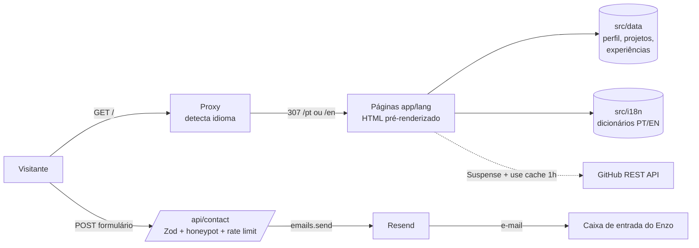

---

## 🔧 Instalação e Execução

### Pré-requisitos
* **Node.js** 22 ou superior (LTS)
* **npm** 10+
* **Docker** e **Docker Compose** (opcional, para rodar em container)
* Uma conta gratuita no **[Resend](https://resend.com/)** (opcional — só para o formulário enviar e-mails)

---

### 🔑 Variáveis de Ambiente

Copie o arquivo de exemplo e preencha:

```bash
cp .env.example .env.local
```

| Variável | Obrigatória | Descrição | Exemplo |
| :--- | :---: | :--- | :--- |
| `RESEND_API_KEY` | Para o formulário | Chave da API do Resend | `re_xxxxxxxx` |
| `CONTACT_TO_EMAIL` | Para o formulário | E-mail que recebe as mensagens | `voce@exemplo.com` |
| `CONTACT_FROM_EMAIL` | Não | Remetente. Sem domínio verificado no Resend, use o padrão | `Portfolio <onboarding@resend.dev>` |
| `GITHUB_TOKEN` | Não | Token do GitHub para subir o limite da API de 60 para 5.000 req/h | `ghp_xxxxxxxx` |
| `HENRIK_API_KEY` | Não | Chave da HenrikDev API para o rank do Valorant | `HDEV-xxxx` |
| `STRAVA_CLIENT_ID` / `STRAVA_CLIENT_SECRET` / `STRAVA_REFRESH_TOKEN` | Não | App do Strava + refresh token (escopo `activity:read`) para o card de treinos | — |

> [!NOTE]
> Sem as variáveis do Resend o site funciona normalmente; apenas o envio do formulário retorna erro e o visitante é orientado a usar o e-mail direto.

Na **Vercel**, cadastre as mesmas variáveis em *Project Settings → Environment Variables*.

---

### 📦 Instalação de Dependências

```bash
git clone https://github.com/Ennzzo/portfolio.git
cd portfolio
npm install
```

---

### ⚡ Como Executar a Aplicação

```bash
npm run dev
```

🚀 *O site estará disponível em **http://localhost:3000** (redireciona para `/pt` ou `/en`).*

Outros scripts:

| Comando | O que faz |
| :--- | :--- |
| `npm run dev` | Servidor de desenvolvimento |
| `npm run build` | Build de produção |
| `npm start` | Servidor de produção (após o build) |
| `npm run lint` | ESLint |
| `npm run typecheck` | Gera os tipos das rotas e checa o TypeScript |
| `npm test` | Testes unitários (Vitest) |

---

### 🐳 Execução com Docker Compose

Com o Docker em execução (Docker Desktop no Mac/Windows ou `sudo systemctl start docker` no Linux):

1. Na raiz do projeto, gere a imagem e suba o container:
```bash
docker compose up --build -d
```
2. Verifique se está rodando:
```bash
docker ps
```
3. Acesse **http://localhost:3000**. Para usar outra porta: `PORT=8080 docker compose up -d`.

4. Para parar e remover:
```bash
docker compose down
```

> [!NOTE]
> O `compose.yaml` lê o `.env.local` automaticamente (se existir). A imagem usa build **multi-stage** e a saída `standalone` do Next.js: a imagem final contém só o servidor mínimo, roda com usuário sem privilégios e não precisa de `node_modules` completo.

Sem Compose:
```bash
docker build -t portfolio .
docker run -p 3000:3000 --env-file .env.local portfolio
```

---

## 🚀 Deploy

O deploy é feito na **Vercel**, integrada ao repositório do GitHub:

1. Em [vercel.com/new](https://vercel.com/new), importe o repositório `Ennzzo/portfolio` (framework detectado: Next.js).
2. Cadastre as variáveis `RESEND_API_KEY` e `CONTACT_TO_EMAIL` (e opcionalmente `GITHUB_TOKEN`).
3. Clique em **Deploy**.

A partir daí, **cada push na `main` gera um deploy de produção** e cada branch/PR ganha uma **URL de preview**. Para rodar a versão de produção em qualquer servidor, use a imagem Docker acima ou:

```bash
npm run build
npm start
```

---

## 📂 Estrutura de Pastas

```
.
├── .github/workflows/ci.yml    # 🤖 CI: lint, tipos, testes, build e imagem Docker
├── .env.example                # 🧩 Variáveis necessárias (sem valores sensíveis)
├── .env.local                  # 🔒 Variáveis locais (não versionado)
├── Dockerfile                  # 🐳 Build multi-stage com saída standalone
├── compose.yaml                # 🐳 Sobe o site com um comando
├── next.config.ts              # ⚙️ Config do Next (standalone, imagens, Cache Components)
├── vitest.config.mts           # 🧪 Config dos testes
├── docs/
│   ├── screenshots/            # 🖼️ Prints das páginas (desktop e mobile)
│   └── wireframes/             # 🎨 Wireframes do Figma
├── public/
│   ├── docs/                   # 📄 Documentos (Honra ao Mérito e Referência Elogiosa)
│   ├── projects/               # 🎞️ GIFs/WebPs dos projetos em funcionamento
│   └── logo.svg                # 🏷️ Logo
├── src/
│   ├── app/
│   │   ├── [lang]/             # 🌐 Páginas por idioma (/pt, /en)
│   │   │   ├── layout.tsx      # 🧱 Layout raiz: cabeçalho, conteúdo e rodapé
│   │   │   ├── page.tsx        # 🏠 Home
│   │   │   ├── about/          # 👋 Sobre mim
│   │   │   ├── projects/       # 🗂️ Linha do tempo de projetos
│   │   │   ├── experience/     # 💼 Experiências
│   │   │   ├── contact/        # 📨 Contato
│   │   │   └── not-found.tsx   # 🚫 Página 404
│   │   ├── api/contact/        # 🔌 Rota de API que envia o e-mail
│   │   ├── globals.css         # 🎨 Tokens de cor e estilos globais
│   │   └── icon.svg            # 🔖 Favicon
│   ├── components/             # 🧱 Componentes reutilizáveis (header, cards, formulário…)
│   │   ├── buck/               # 🐕 Mascote em SVG, passeio, foto e easter egg
│   │   ├── fx/                 # ✨ Cursor, título interativo e fundo em grade
│   │   ├── game/               # 🎯 Jogo AIM BUCK! e pontuação
│   │   └── off-clock/          # 🎮 Cards de Strava, Letterboxd e Valorant
│   ├── data/                   # 🗃️ Conteúdo: perfil, projetos e experiências (PT/EN)
│   ├── i18n/                   # 🌎 Idiomas, dicionários e negociação de idioma
│   ├── lib/                    # 🛠️ API do GitHub, schema do formulário, formatação
│   │   └── integrations/       # 🔌 Clientes de Strava, Letterboxd e Valorant
│   └── proxy.ts                # 🔀 Redireciona para o idioma do navegador
└── tests/                      # 🧪 Testes unitários (Vitest)
```

---

## 🎥 Demonstração

### 🌐 Aplicação Web

| Página | Desktop |
| :---: | :---: |
| **Home** | 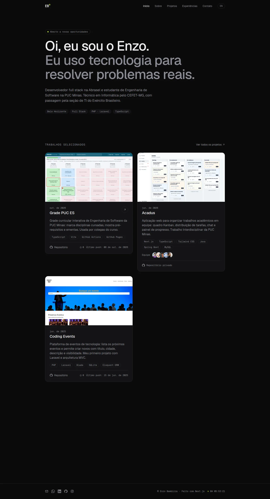 |
| **Sobre mim** | 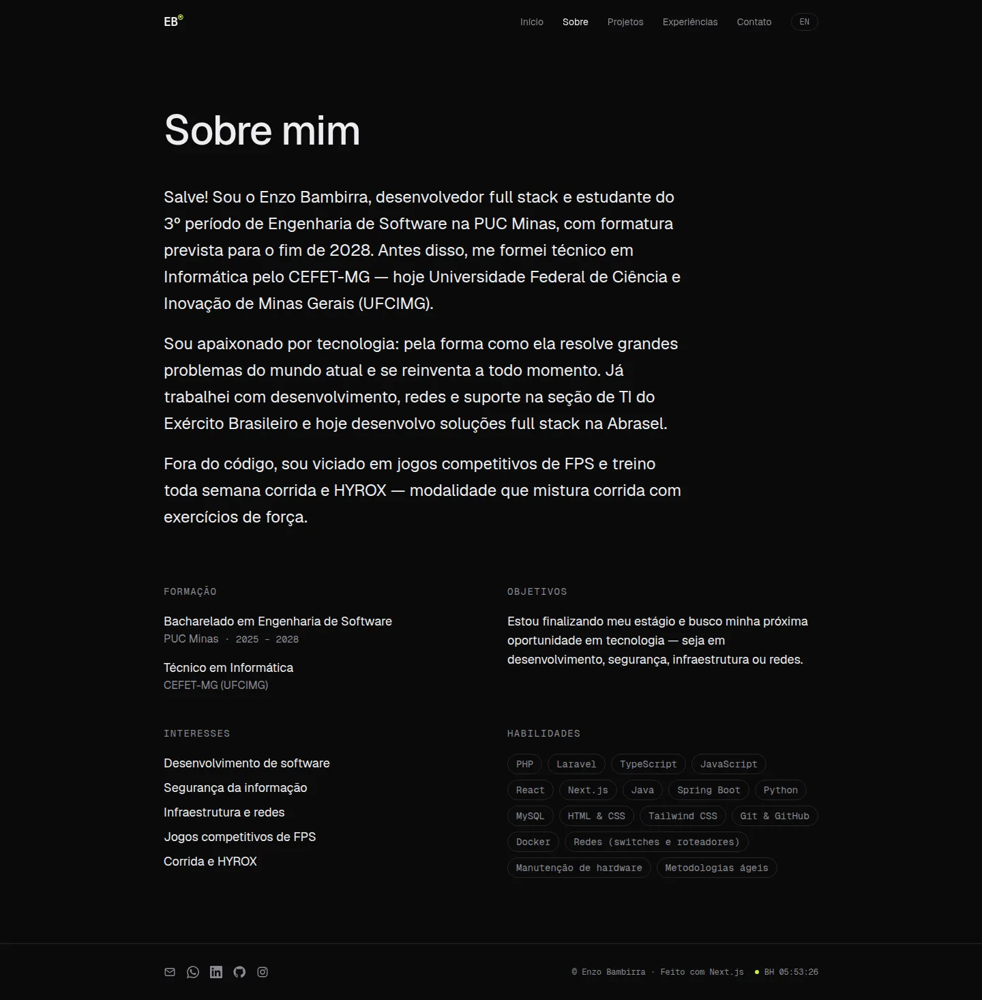 |
| **Projetos (linha do tempo)** | 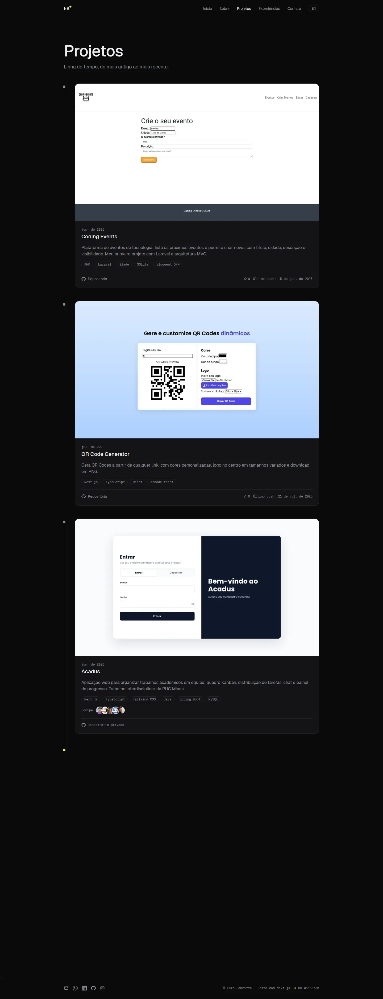 |
| **Experiências** | 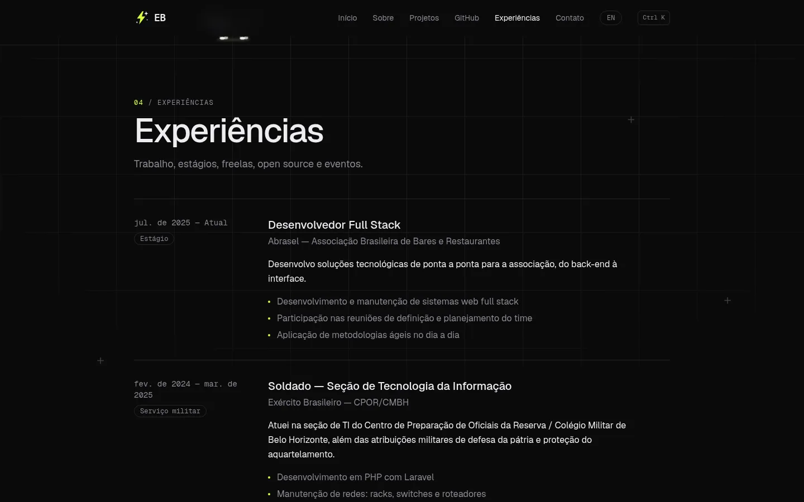 |
| **Contato** | 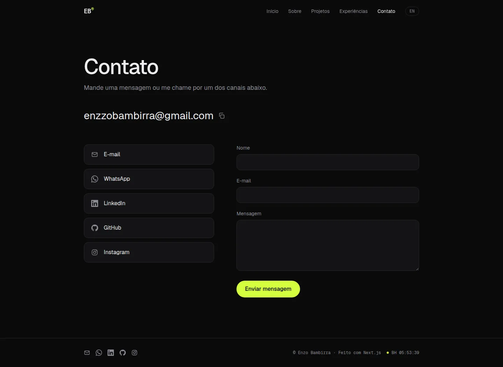 |
| **Home em inglês** | 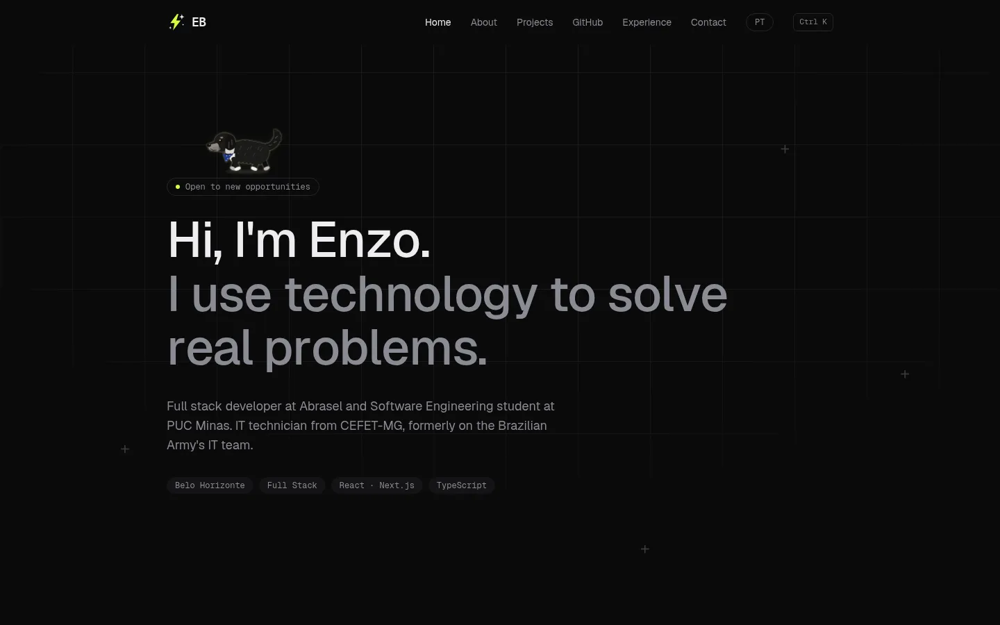 |

### 📱 Mobile

| Home | Sobre | Projetos | Experiências | Contato |
| :---: | :---: | :---: | :---: | :---: |
| 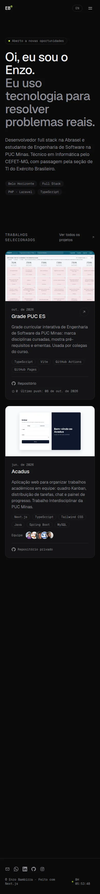 | 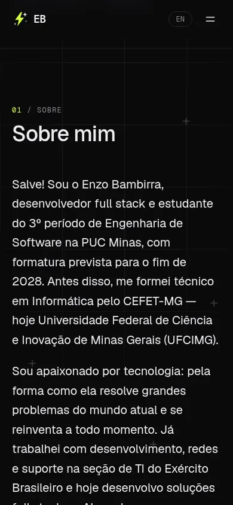 | 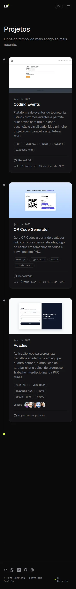 | 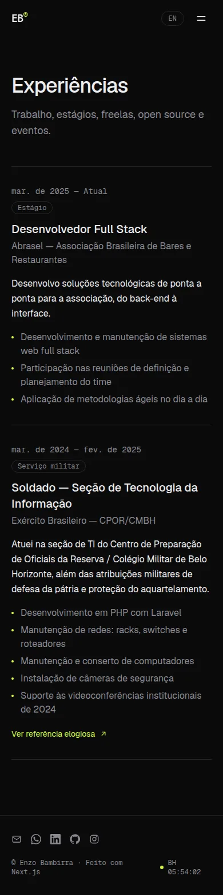 | 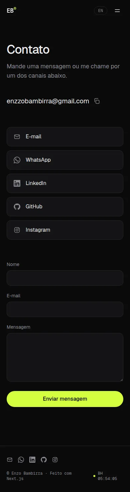 |

### 🎞️ Projetos em funcionamento (exibidos no site)

| Grade PUC ES | Acadus |
| :---: | :---: |
| 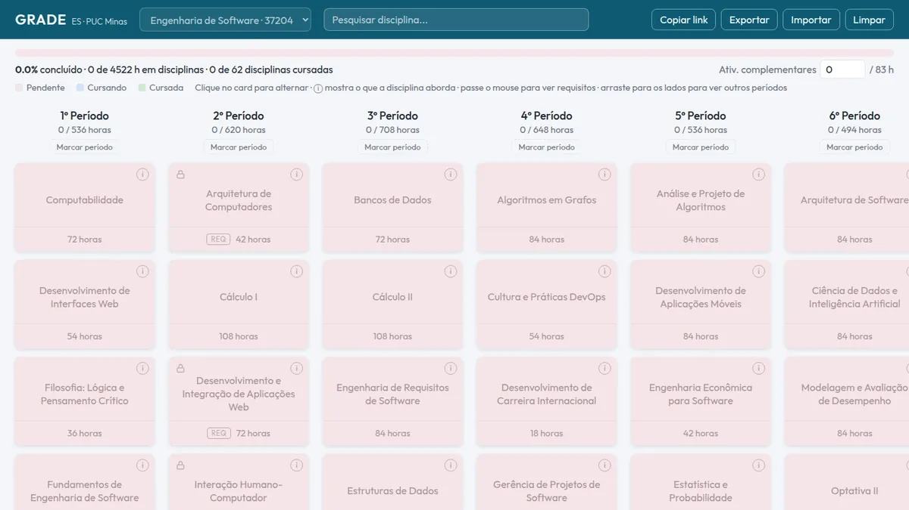 | 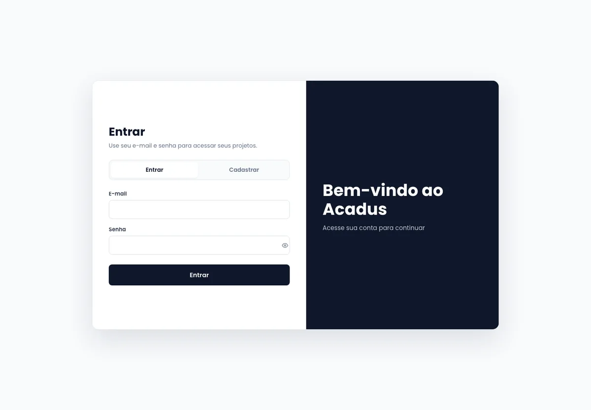 |
| **QR Code Generator** | **Coding Events** |
| 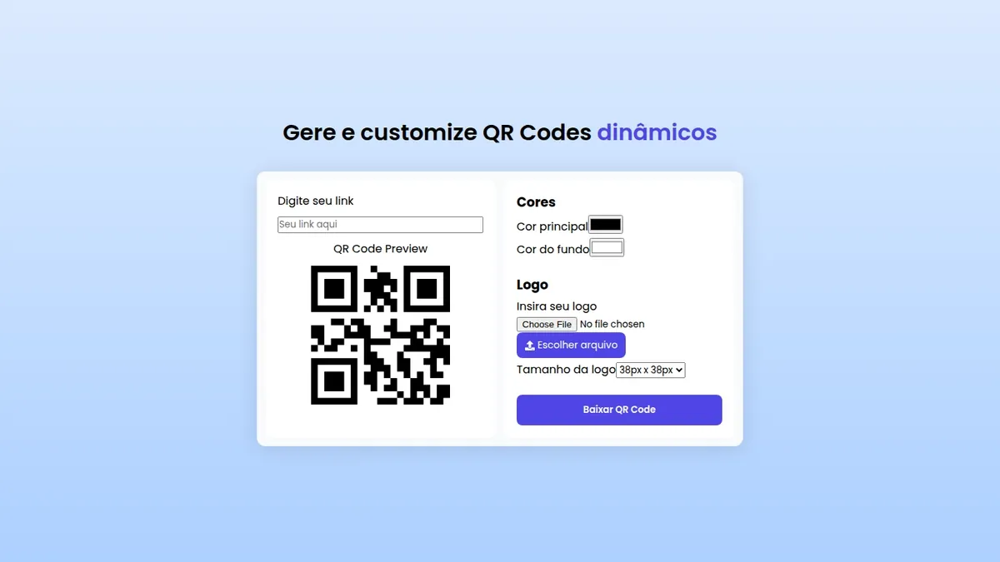 | 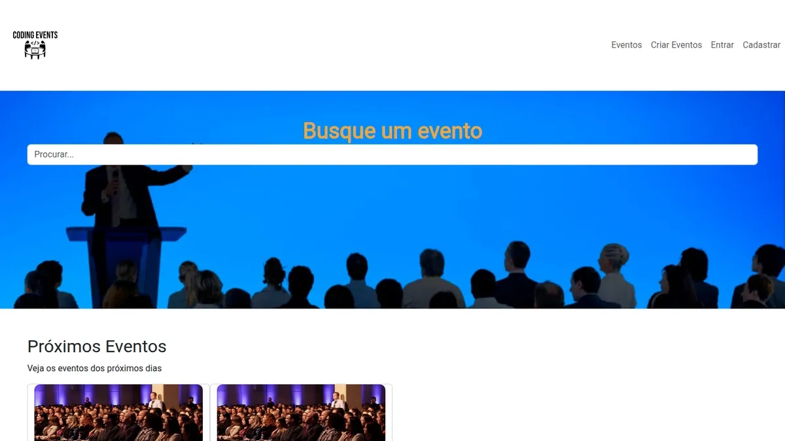 |

### 💻 Exemplo de saída no terminal (API de contato)

```bash
curl -X POST http://localhost:3000/api/contact \
     -H 'Content-Type: application/json' \
     -d '{"name":"Maria","email":"maria@example.com","message":"Olá, vi seu portfolio!"}'
```

**Saída esperada:**
```json
{ "ok": true }
```

Com dados inválidos (`HTTP 400`):
```json
{ "error": "invalid", "fields": ["name", "email", "message"] }
```

---

## 🧪 Testes

```bash
npm test
```

Testes unitários com **Vitest** (31 casos):

| Arquivo | O que cobre |
| :--- | :--- |
| `tests/negotiate.test.ts` | Escolha do idioma pelo `Accept-Language` (pesos `q`, idiomas não suportados) |
| `tests/format.test.ts` | Formatação de datas em PT e EN |
| `tests/contact-schema.test.ts` | Validação do formulário e honeypot |
| `tests/contact-route.test.ts` | Rota `/api/contact`: envio, 400/500/502, escape de HTML e limite de 5 envios por IP |
| `tests/scoring.test.ts` | Pontuação do jogo: precisão, reação média e ranks |
| `tests/integrations.test.ts` | Conversão dos dados de Valorant (ranks e ícones), Letterboxd e Strava |

A CI do GitHub Actions roda lint, checagem de tipos, testes, build e build da imagem Docker a cada push.

---

## 🔗 Documentações utilizadas

* [Next.js — documentação](https://nextjs.org/docs) (App Router, Internationalization, Proxy, Route Handlers, Cache Components, `output: standalone`)
* [React](https://react.dev/)
* [Tailwind CSS](https://tailwindcss.com/docs)
* [Motion](https://motion.dev/docs/react)
* [Zod](https://zod.dev/)
* [Resend — Node.js SDK](https://resend.com/docs/send-with-nodejs)
* [GitHub REST API — Repositories](https://docs.github.com/rest/repos/repos)
* [Docker — Next.js guide](https://docs.docker.com/guides/nextjs/)
* [Vitest](https://vitest.dev/)
* [Vercel — Deploy Next.js](https://vercel.com/docs/frameworks/nextjs)

---

## 👤 Autor

| [](https://github.com/Ennzzo) |
| :---: |
| **Enzo Bambirra** |
| [GitHub](https://github.com/Ennzzo) · [LinkedIn](https://www.linkedin.com/in/enzobambirra) · [E-mail](mailto:enzzobambirra@gmail.com) |

---

## 🤝 Contribuição

Encontrou um erro de digitação ou bug? Fique à vontade para abrir uma issue ou PR:

1. Faça um fork do projeto
2. Crie uma branch: `git checkout -b fix/descricao`
3. Faça commits seguindo o [Conventional Commits](https://www.conventionalcommits.org/) ou mensagens descritivas
4. Envie a branch: `git push origin fix/descricao`
5. Abra um Pull Request

---

## 🙏 Agradecimentos

* Ao **Prof. Dr. João Paulo Aramuni**, pela proposta do laboratório e pelo template deste README.
* À **PUC Minas** e ao **CEFET-MG (UFCIMG)**, pela formação.
* Aos colegas do **Acadus** — Francisco, Rafael, Sofia e Thiago — pelo projeto em equipe exibido aqui.

---

## 📄 Licença

O **código** deste projeto está sob a licença MIT. O **conteúdo pessoal** (textos, imagens, documentos e GIFs dos projetos) pertence ao autor e não deve ser reutilizado sem autorização.
