<!-- README baseado no template do Prof. Dr. João Paulo Aramuni (DIAW, PUC Minas) -->

---

# 🏷️ Portfolio - Enzo Bambirra 👨‍💻

> [!NOTE]
> Meu portfolio profissional, em português e inglês, com projetos, experiências, contribuições do GitHub e formulário de contato que envia e-mail.

<table>
  <tr>
    <td width="800px">
      <div align="justify">
        Este é o meu portfolio. Comecei como o Laboratório 01 da disciplina de Desenvolvimento e Integração de Aplicações Web (DIAW), em Engenharia de Software na PUC Minas, mas fiz pensando em usar de verdade para procurar vaga. O site é uma página única com sobre mim, linha do tempo de projetos (cada um com um GIF dele funcionando), contribuições do GitHub, experiências, um design system e contato. Usei Next.js, TypeScript e Tailwind, o formulário tem back-end próprio, o projeto roda em Docker, tem testes e CI, e está publicado na Vercel.
      </div>
    </td>
    <td>
      <div>
        
      </div>
    </td>
  </tr>
</table>

---

## 🚧 Status do Projeto

[](https://github.com/Ennzzo/portfolio/actions/workflows/ci.yml)
[](https://enzobambirra.vercel.app)


---

## 📚 Índice
- [Links Úteis](#-links-úteis)
- [Sobre o Projeto](#-sobre-o-projeto)
- [Funcionalidades Principais](#-funcionalidades-principais)
- [Tecnologias Utilizadas](#-tecnologias-utilizadas)
- [Arquitetura](#-arquitetura)
- [Instalação e Execução](#-instalação-e-execução)
- [Deploy](#-deploy)
- [Estrutura de Pastas](#-estrutura-de-pastas)
- [Protótipos](#-protótipos)
- [Demonstração](#-demonstração)
- [Testes](#-testes)
- [Documentações utilizadas](#-documentações-utilizadas)
- [Autor](#-autor)
- [Contribuição](#-contribuição)
- [Agradecimentos](#-agradecimentos)
- [Licença](#-licença)

---

## 🔗 Links Úteis
* 🌐 **Site:** [enzobambirra.vercel.app](https://enzobambirra.vercel.app) (atualiza sozinho a cada push na `main`)
* 📦 **Repositório:** [github.com/Ennzzo/portfolio](https://github.com/Ennzzo/portfolio)
* 📐 **Protótipos:** [docs/wireframes](docs/wireframes)

---

## 📝 Sobre o Projeto

A atividade pedia um site de portfolio com sobre mim em dois idiomas, projetos em linha do tempo, experiências e contato. Resolvi aproveitar e fazer um que eu realmente fosse usar no LinkedIn e em processos seletivos, em vez de só cumprir a lista.

A ideia é que quem abrir o site entenda rápido quem eu sou, veja os projetos funcionando (por isso os GIFs) e consiga falar comigo sem sair da página. Algumas informações se atualizam sozinhas, como as estrelas e o último push de cada repositório e o calendário de contribuições do GitHub.

Para o visual me inspirei em portfolios como o [munim.io](https://www.munim.io/) e o [product.inc](https://www.product.inc/), além dos exemplos do enunciado. O Buck, que anda pela página e pode ser arremessado, é o meu cachorro.

---

## ✨ Funcionalidades Principais

- Site em português e inglês, com troca de idioma em qualquer seção. Na primeira visita o idioma vem do navegador.
- Página única com as seções Início, Sobre, Projetos, GitHub, Experiências, Design System e Contato. O menu marca a seção em que você está. As URLs antigas (`/pt/about` etc.) redirecionam para a seção certa.
- Tema claro e escuro, com botão no cabeçalho. Segue o tema do sistema na primeira visita e lembra a escolha.
- Linha do tempo de projetos com descrição, tecnologias, link do repositório, equipe (no projeto em grupo) e GIF do projeto rodando.
- Estrelas e último push de cada repositório, buscados na API do GitHub.
- Calendário de contribuições do GitHub dos últimos 12 meses, com total, dias ativos, maior sequência e melhor dia.
- Experiências com empresa, cargo, período, descrição e documentos (diploma e referência elogiosa do Exército).
- Contato por WhatsApp (abre a conversa com a mensagem já escrita), e-mail com cópia em um clique, redes sociais e formulário que envia e-mail pelo back-end.
- Formulário validado com Zod no navegador e no servidor, com honeypot contra spam, limite de envios por IP e escape de HTML.
- Seção de Design System com cores dos dois temas, tipografia, componentes, formas e animações.
- O Buck: anda sobre títulos, cards e divisórias, dá para arrastar e arremessar (com gravidade, quique e colisão nas paredes) e, clicando nele, abre o jogo AIM BUCK!, um treino de mira com ranks do Ferro ao Radiante.
- Detalhes de interação: letras do título que acendem com o mouse, cursor próprio, intro com "olá" em vários idiomas, menu Ctrl+K e o Konami code como easter egg.
- Imagem de preview para compartilhar o link, `sitemap.xml`, `robots.txt` e `hreflang`.
- Layout responsivo, foco visível, `aria-*` nos componentes interativos e respeito a quem prefere menos animação.

---

## 🛠 Tecnologias Utilizadas

### 💻 Front-end
* **Framework:** [Next.js 16](https://nextjs.org/) (App Router) com [React 19](https://react.dev/)
* **Linguagem:** [TypeScript](https://www.typescriptlang.org/)
* **Estilo:** [Tailwind CSS 4](https://tailwindcss.com/) com variáveis CSS para os dois temas
* **Animações:** [Motion](https://motion.dev/) e CSS
* **Validação:** [Zod](https://zod.dev/)
* **Fontes:** Geist e Geist Mono (`next/font`)

### 🖥️ Back-end
* **Runtime:** Node.js 22
* **API:** Route Handler do Next.js em `POST /api/contact`, e o `proxy.ts` para o roteamento por idioma
* **E-mail:** [Resend](https://resend.com/)
* **APIs externas:** [GitHub REST API](https://docs.github.com/rest) e [GitHub Contributions API](https://github.com/grubersjoe/github-contributions-api)
* **Banco de dados:** não usa. O conteúdo fica em arquivos TypeScript em `src/data`.

### ⚙️ Infraestrutura & DevOps
* **Containers:** Docker (multi-stage, saída `standalone`) e Docker Compose
* **Hospedagem:** [Vercel](https://vercel.com/)
* **CI:** GitHub Actions (lint, tipos, testes, build e imagem Docker)
* **Qualidade:** ESLint e Vitest

### 📦 Dependências

| Pacote | Versão | Uso |
| :--- | :--- | :--- |
| `next` | 16.4.0 | Framework (páginas, API, proxy, imagens) |
| `react` / `react-dom` | 19.3.0 | Interface |
| `motion` | ^14.2.0 | Animações |
| `resend` | ^6.32.1 | Envio dos e-mails do formulário |
| `zod` | ^4.6.7 | Validação do formulário |
| `tailwindcss` + `@tailwindcss/turbopack` | ^4 | Estilo |
| `typescript` | ^5 | Tipagem |
| `eslint` + `eslint-config-next` | ^9 / 16.4.0 | Lint |
| `vitest` | ^5.0.4 | Testes |
| `playwright` | 1.64.0 | Gerar os wireframes a partir do site |

---

## 🏗 Arquitetura

É um projeto Next.js só, com front e back no mesmo repositório e no mesmo deploy.

- `app/[lang]/page.tsx` monta a página com as seções de `components/sections`. Cada seção tem um `id` que o menu usa. As versões `/pt` e `/en` são geradas no build como HTML estático.
- `proxy.ts` manda quem entra em `/` para `/pt` ou `/en`, olhando o idioma do navegador.
- O conteúdo (perfil, projetos, experiências) fica em `src/data` com os textos em `{ pt, en }`. Para adicionar um projeto basta editar um arquivo.
- Os textos da interface ficam em `src/i18n`. O dicionário em inglês usa o tipo do português, então se faltar uma chave o build quebra.
- Quase tudo é Server Component. Só vira Client Component o que tem interação (menu, formulário, cursor, Buck, jogo).
- As chamadas ao GitHub usam `"use cache"` com validade de 1 hora e aparecem dentro de `<Suspense>`, sem travar o resto da página. Se a API falhar, a falha não fica no cache.
- `/api/contact` valida com o mesmo schema do formulário, checa o honeypot e o limite por IP, escapa o HTML e envia pelo Resend com o e-mail do visitante no `replyTo`.

O limite por IP fica em memória. Para um portfolio é suficiente; com várias instâncias eu usaria Redis.

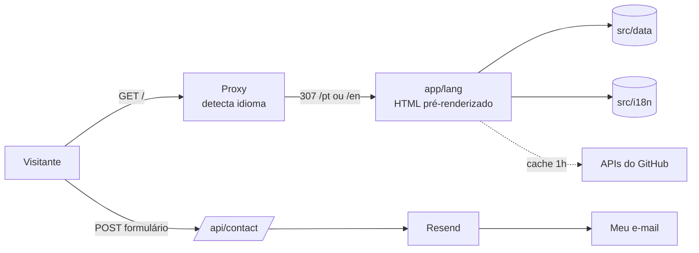

---

## 🔧 Instalação e Execução

### Pré-requisitos
* Node.js 22 ou mais novo e npm 10+
* Docker e Docker Compose, se quiser rodar em container
* Conta gratuita no [Resend](https://resend.com/), só se quiser que o formulário envie e-mail

### 🔑 Variáveis de Ambiente

```bash
cp .env.example .env.local
```

| Variável | Obrigatória | Para que serve | Exemplo |
| :--- | :---: | :--- | :--- |
| `RESEND_API_KEY` | Para o formulário | Chave do Resend | `re_xxxxxxxx` |
| `CONTACT_TO_EMAIL` | Para o formulário | E-mail que recebe as mensagens | `voce@exemplo.com` |
| `CONTACT_FROM_EMAIL` | Não | Remetente (sem domínio próprio, use o padrão) | `Portfolio <onboarding@resend.dev>` |
| `NEXT_PUBLIC_SITE_URL` | Não | URL usada no sitemap e na imagem de preview | `https://enzobambirra.vercel.app` |
| `GITHUB_TOKEN` | Não | Aumenta o limite da API do GitHub de 60 para 5.000 req/h | `ghp_xxxxxxxx` |

Sem as variáveis do Resend o site funciona normal, só o formulário mostra erro e sugere o e-mail direto.

### 📦 Instalação de Dependências

```bash
git clone https://github.com/Ennzzo/portfolio.git
cd portfolio
npm install
```

### ⚡ Como Executar a Aplicação

```bash
npm run dev
```

O site abre em http://localhost:3000.

| Comando | O que faz |
| :--- | :--- |
| `npm run dev` | Servidor de desenvolvimento |
| `npm run build` | Build de produção |
| `npm start` | Roda o build de produção |
| `npm run lint` | ESLint |
| `npm run typecheck` | Gera os tipos das rotas e roda o TypeScript |
| `npm test` | Testes (Vitest) |
| `npm run wireframes` | Gera os wireframes de `docs/wireframes` a partir do site rodando |

### 🐳 Execução com Docker Compose

Com o Docker rodando:

```bash
docker compose up --build -d   # sobe em http://localhost:3000
docker ps                      # confere o container
docker compose down            # para e remove
```

Para outra porta: `PORT=8080 docker compose up -d`. O `compose.yaml` lê o `.env.local` se ele existir. A imagem final tem só o servidor `standalone` do Next e roda com um usuário sem privilégios.

Sem o Compose:

```bash
docker build -t portfolio .
docker run -p 3000:3000 --env-file .env.local portfolio
```

---

## 🚀 Deploy

O site está na Vercel, ligada a este repositório:

1. Importar o repositório em [vercel.com/new](https://vercel.com/new) (o Next.js é detectado sozinho).
2. Cadastrar `RESEND_API_KEY` e `CONTACT_TO_EMAIL` em Environment Variables.
3. Deploy.

Cada push na `main` publica uma nova versão, e cada branch ganha uma URL de preview. Fora da Vercel dá para usar a imagem Docker ou `npm run build && npm start`.

---

## 📂 Estrutura de Pastas

```
.
├── .github/workflows/ci.yml   # CI: lint, tipos, testes, build e Docker
├── .env.example               # variáveis necessárias, sem valores
├── Dockerfile / compose.yaml  # container
├── docs/
│   ├── screenshots/           # prints das seções
│   └── wireframes/            # protótipos (SVG) de cada seção, desktop e mobile
├── public/
│   ├── docs/                  # diploma, referência elogiosa e certificado
│   ├── projects/              # GIFs dos projetos
│   └── logo.svg
├── scripts/
│   └── wireframes.mjs         # gera os wireframes a partir do layout real
├── src/
│   ├── app/
│   │   ├── [lang]/            # layout, página e 404 por idioma
│   │   ├── api/contact/       # envio de e-mail
│   │   ├── sitemap.ts / robots.ts
│   │   └── globals.css        # variáveis dos temas e estilos globais
│   ├── components/
│   │   ├── sections/          # seções da página
│   │   ├── buck/              # desenho, física, foto e easter egg do Buck
│   │   ├── game/              # jogo AIM BUCK!
│   │   └── fx/                # cursor, título e fundo
│   ├── data/                  # perfil, projetos, experiências e design system
│   ├── i18n/                  # idiomas e textos
│   ├── lib/                   # GitHub, tema, formulário, formatação
│   └── proxy.ts               # redireciona pelo idioma
└── tests/                     # testes (Vitest)
```

---

## 📐 Protótipos

Os protótipos (wireframes de média fidelidade) de cada seção, em desktop e mobile, estão em [`docs/wireframes`](docs/wireframes) como SVG. Títulos aparecem com o texto real, parágrafos viram barras, imagens viram caixas com X e botões e campos aparecem só com o contorno. Eles são gerados a partir do layout do próprio site com `npm run wireframes`, então ficam sempre iguais ao que está publicado.

| Seção | Desktop | Mobile |
| :---: | :---: | :---: |
| Início | 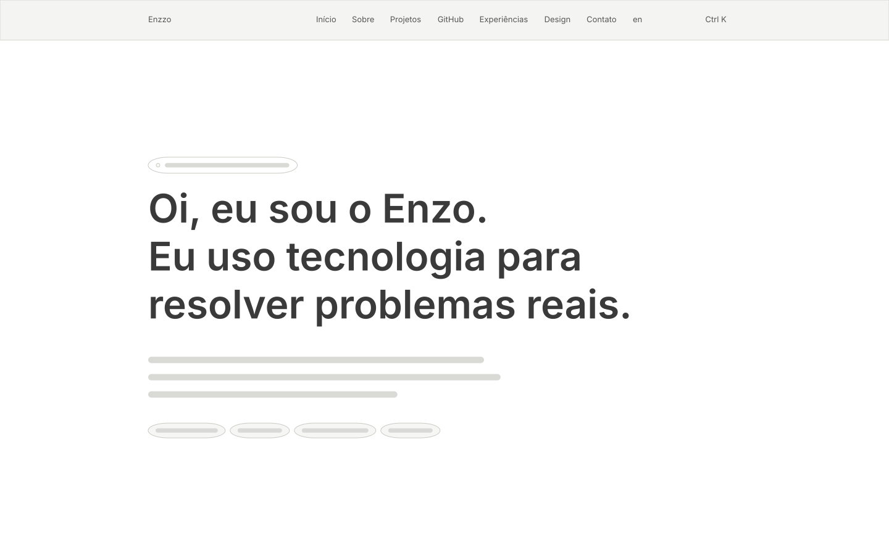 | 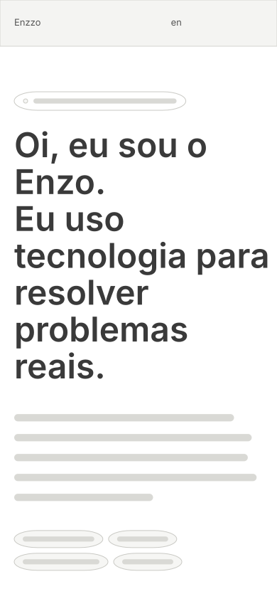 |
| Sobre | 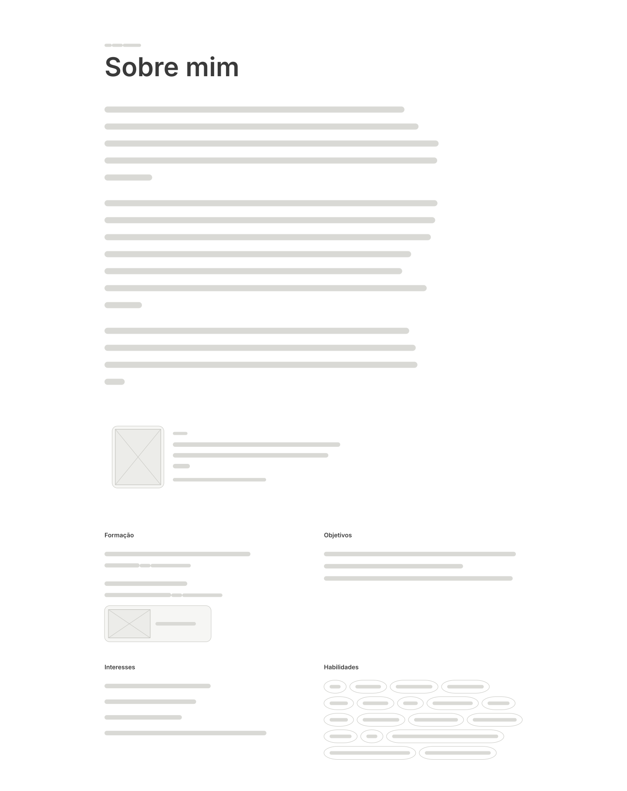 | 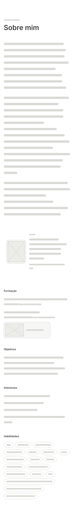 |
| Projetos | 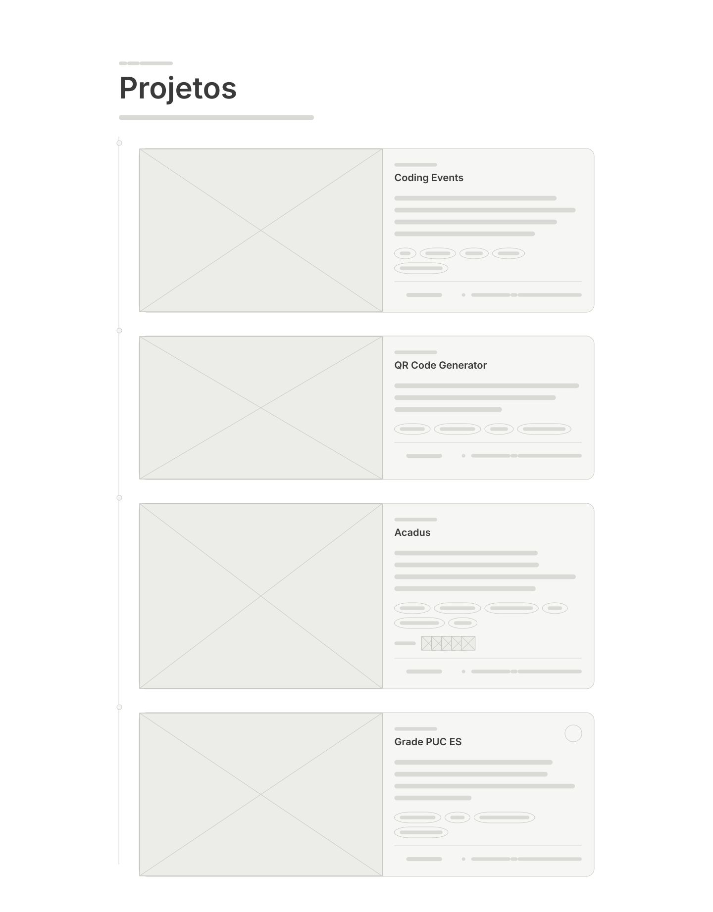 | 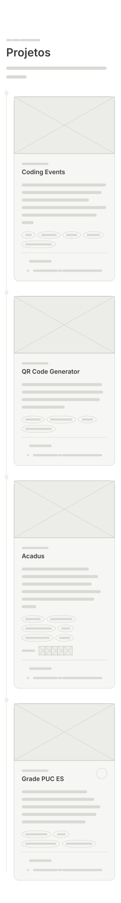 |
| GitHub | 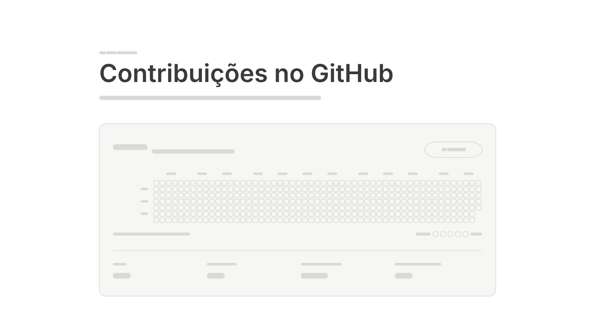 | 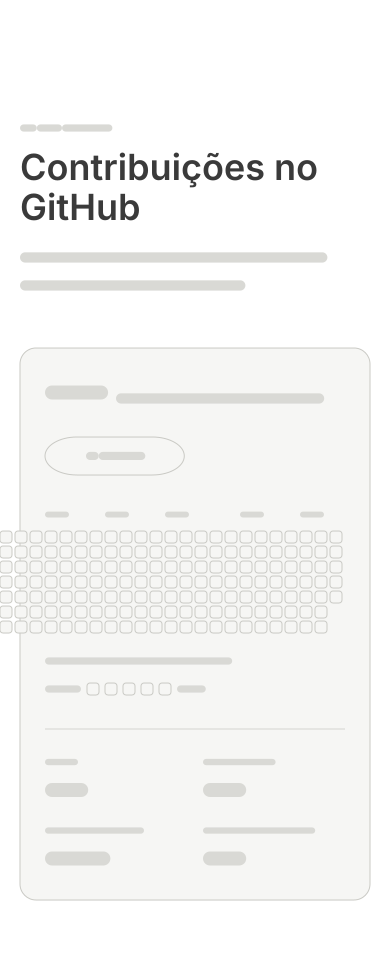 |
| Experiências | 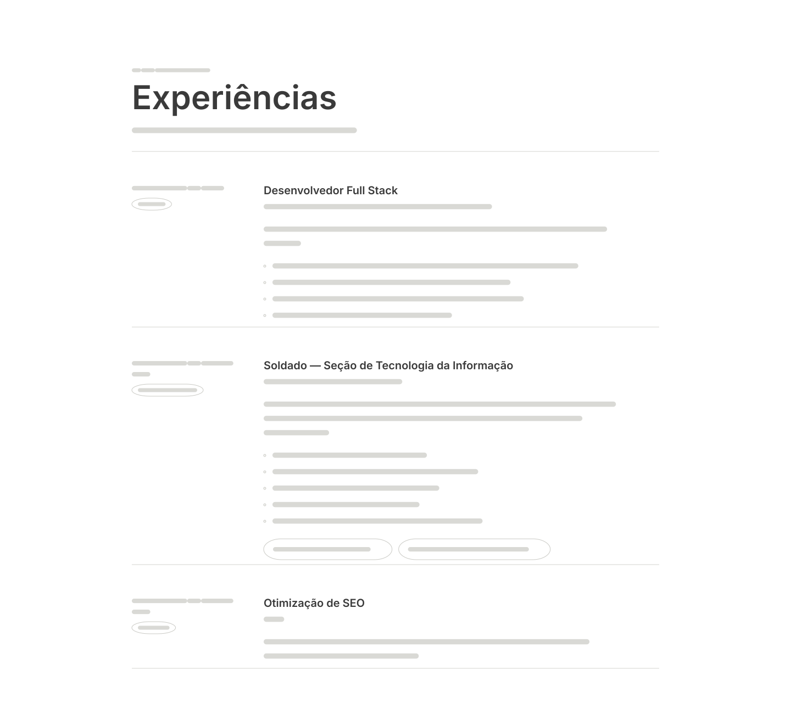 | 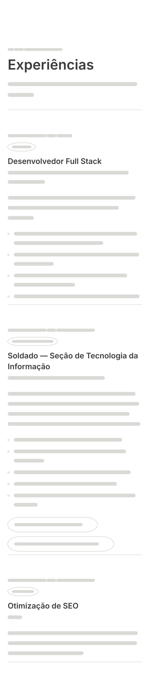 |
| Design System | 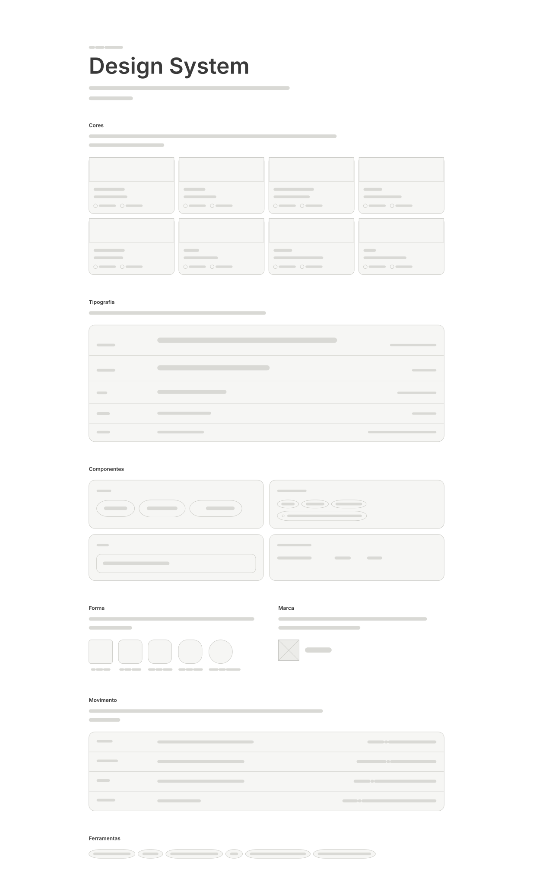 | 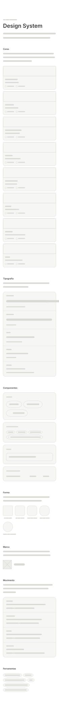 |
| Contato | 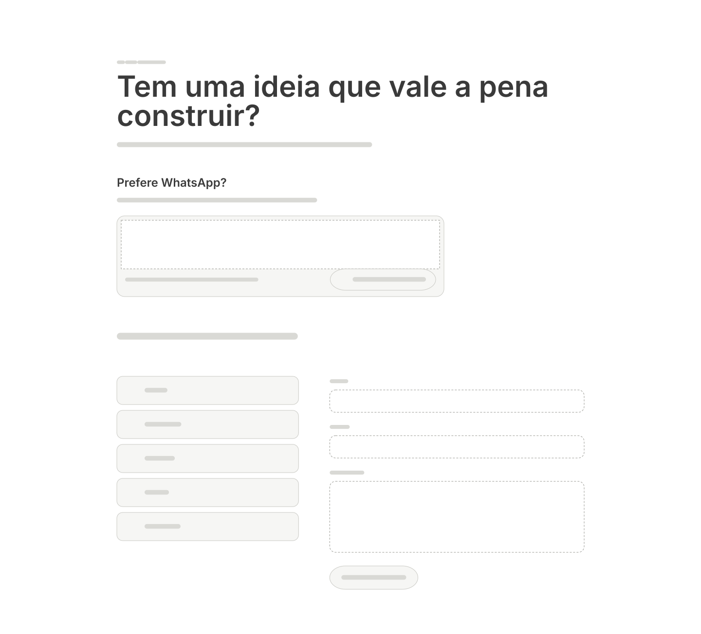 | 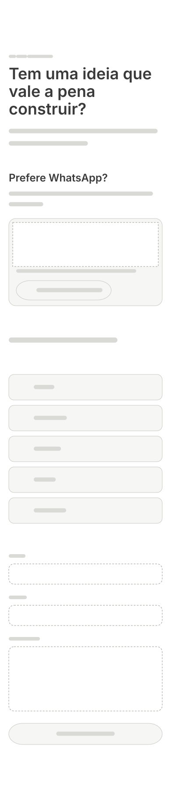 |

---

## 🎥 Demonstração

### 🌐 Aplicação Web

| Seção | Desktop |
| :---: | :---: |
| Início |  |
| Sobre |  |
| Projetos |  |
| GitHub | 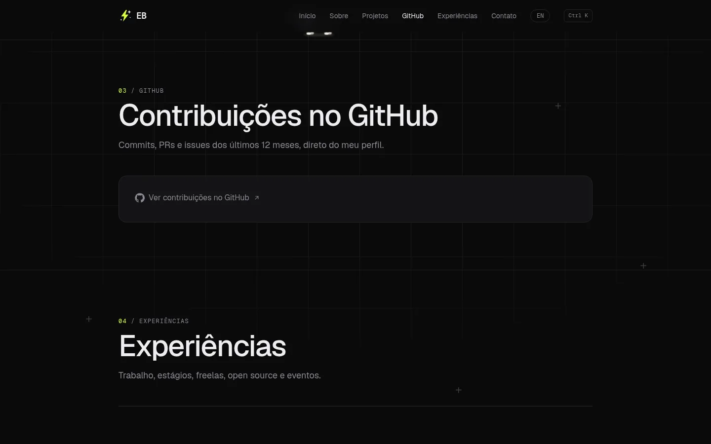 |
| Experiências |  |
| Contato |  |
| Início em inglês |  |

### 📱 Mobile

| Início | Sobre | Projetos | Experiências | Contato |
| :---: | :---: | :---: | :---: | :---: |
|  |  |  |  |  |

### 🎞️ Projetos que aparecem no site

| Grade PUC ES | Acadus |
| :---: | :---: |
|  |  |
| **QR Code Generator** | **Coding Events** |
|  |  |

### 💻 API de contato pelo terminal

```bash
curl -X POST http://localhost:3000/api/contact \
     -H 'Content-Type: application/json' \
     -d '{"name":"Maria","email":"maria@example.com","message":"Olá, vi seu portfolio!"}'
```

Resposta:
```json
{ "ok": true }
```

Com dados inválidos (`400`):
```json
{ "error": "invalid", "fields": ["name", "email", "message"] }
```

---

## 🧪 Testes

```bash
npm test
```

| Arquivo | O que testa |
| :--- | :--- |
| `tests/negotiate.test.ts` | Escolha do idioma pelo `Accept-Language` |
| `tests/format.test.ts` | Datas em PT e EN |
| `tests/contact-schema.test.ts` | Validação do formulário e honeypot |
| `tests/contact-route.test.ts` | `/api/contact`: envio, erros, escape de HTML e limite por IP |
| `tests/scoring.test.ts` | Pontos e ranks do jogo |
| `tests/buck-physics.test.ts` | Queda, pouso, quique, paredes e arremesso do Buck |
| `tests/github-contributions.test.ts` | Calendário de contribuições e sequências |

A CI roda lint, tipos, testes, build e build da imagem Docker em todo push.

No Lighthouse do site publicado: 97 de performance no desktop e 87 no mobile, e 100 em acessibilidade, boas práticas e SEO.

---

## 🔗 Documentações utilizadas

* [Next.js](https://nextjs.org/docs) (App Router, internacionalização, Proxy, Route Handlers, cache, `output: standalone`)
* [React](https://react.dev/)
* [Tailwind CSS](https://tailwindcss.com/docs)
* [Motion](https://motion.dev/docs/react)
* [Zod](https://zod.dev/)
* [Resend (Node.js)](https://resend.com/docs/send-with-nodejs)
* [GitHub REST API](https://docs.github.com/rest/repos/repos)
* [Docker: guia de Next.js](https://docs.docker.com/guides/nextjs/)
* [Vitest](https://vitest.dev/)
* [Playwright](https://playwright.dev/)
* [Vercel: Next.js](https://vercel.com/docs/frameworks/nextjs)

---

## 👤 Autor

| [](https://github.com/Ennzzo) |
| :---: |
| **Enzo Bambirra** |
| [GitHub](https://github.com/Ennzzo) · [LinkedIn](https://www.linkedin.com/in/enzobambirra) · [E-mail](mailto:enzzobambirra@gmail.com) |

---

## 🤝 Contribuição

Achou um erro ou tem uma sugestão? Pode abrir uma issue ou mandar um PR: faça um fork, crie uma branch (`git checkout -b fix/descricao`), faça os commits e abra o Pull Request.

---

## 🙏 Agradecimentos

* Ao Prof. Dr. João Paulo Aramuni, pela proposta do laboratório e pelo template deste README.
* À PUC Minas e ao CEFET-MG (UFCIMG), pela formação.
* À equipe do Acadus (Francisco, Rafael, Sofia e Thiago), por deixar o projeto aparecer aqui.

---

## 📄 Licença

O código está sob a licença MIT. O conteúdo pessoal (textos, fotos, documentos e GIFs dos projetos) é meu e não deve ser reutilizado sem autorização.
